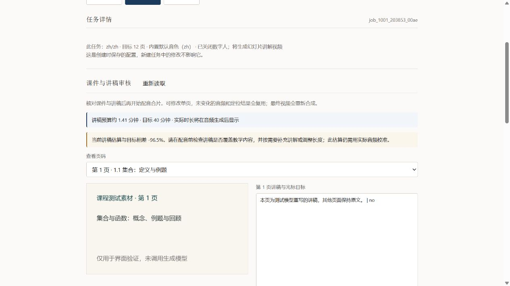

# 课程时长与课件讲稿审核

2026-10-01。Web 新建任务现在统一采用：准备课件与讲稿 → 暂停审核 → 用户确认 → 配音、光标定位与合片。论文、教材、故事、小说/漫画、通用内容都适用。原有声音克隆试听入口保留。

## 使用方法

1. 上传素材并完成提取预览，检查文字是否完整。
2. 选择讲解内容类型、语言和页数。教材/课程会默认打开教学设置；其他内容也可以主动勾选。
3. 做长课时，选择本次章节/小节，填写受众、目标、重点和讲解方式。时长可自动分配，也可设置 1～180 分钟，例如 40 分钟。
4. 点击“预览 / 更新教案”，调整分节标题和分钟数，再勾选确认。自定义模式的分节时间之和必须等于目标时间。改变素材、范围、语言、页数或教学设置后，需要重新更新并确认。
5. 点击“生成课件与讲稿”。此步可能调用模型，但不会合成讲稿音频或视频；完成后状态为“课件与讲稿待审核”。
6. 在任务详情逐页核对课件和讲稿。可以直接编辑并保存，也可以点击“调用模型重写本页”；后者明确提示模型调用费用，其他页保留，重写完成后再次等待审核。
7. 勾选“已核对所有课件和讲稿”，再点击“确认并生成配音视频”。已审核讲稿严格复用，不会因讲稿损坏而偷偷改为模型重写。

审核中的课件可以点击放大和下载；当前编辑器编辑的是讲稿及光标目标，不提供幻灯片源码的可视化编辑。课件内容需要大改时，应修改素材/教案后新建准备任务。

## 时长口径

- “目标分钟数”表示视频希望讲多久；“完整流程生成耗时粗估”表示机器需要等多久，两者分别显示。
- 语速只用于讲稿长度预算，默认中文 220 字/分钟。请按自己音色的实际播放情况调整预算语速，不会修改音色或拉伸音频。
- 教案预览按材料长度分配时间和页数，是本机确定性计算，不是模型已经检查过教学内容。
- 授课讲稿按实际课件逐页生成，附对应源材料、时间预算和前页摘要，覆盖原短讲稿模板的固定长度限制。源材料不足会提示，不能把重复内容或虚构例题当作扩写。
- 审核前显示讲稿估算时长；偏离目标超过 ±10% 会提示。音频生成后显示实际时长与偏差，仍需人工决定哪些页补充或精简。
- ±10% 是提示阈值，不是生成保证；没有自动反复重写直到命中时长的循环。尚未进行完整 40 分钟真实模型/GPU 出片标定。

## 讲稿编辑与恢复

每行保留以下形式，光标短语应来自本页可见文字；没有适合目标时使用 `no`：

```text
这里解释集合与元素之间的归属关系。 | 集合
接下来通过一个例题回顾。 | no
```

网页维护分页，页内不能自行插入 `###`。保存时提交全部页，后端检查数量、格式和版本；每页最多 20000 字符，总正文最多 200000 字符，审核请求体还受 512000 字节限制。

- 旧讲稿保存在结果目录的 `script_versions/`，文件名是旧内容指纹；重新读取前会提示未保存编辑。
- 准备失败/取消可以“继续准备课件与讲稿”，恢复后仍需审核；局部重写失败恢复保留原选中页范围。
- 初次课程讲稿按页缓存，未变化且已完成的页可以复用。多页模型重写失败后，重试可能再次调用原来选中的已成功页，未选中页不会重写。
- 长页配音拆为不超过 400 字符的片段；页级与片段级都按文字、参考音色和配置验证缓存。中途失败保留已经完成的音频片段。
- 修改一页，只更新相关页音频；参考音色变化会使相关音频缓存失效。定位坐标和强制对齐也验证对应输入后复用，视频最终重新合成。
- 审核保存、重写或配音任务共用一份结果目录。该目录已有排队/运行任务时，拒绝另一个覆盖操作；过期版本不能覆盖新版本。
- 全局课件缓存只在初始准备阶段读取，续跑不会用缓存覆盖手工审核讲稿，也不会把修改后的讲稿回写到原初始缓存。

## 课程章节输出

课程模式在配音后写入 `course_timing.json`、`chapters.json` 和 `chapters.txt`，时间轴按完整页音频长度累计，包含片段停顿。成片额外生成带内嵌章节的 `course_video.mp4`，页面优先播放它，并提供章节跳转按钮。原 `3_merage.mp4` 保留。

## 素材边界

- 幻灯片目标 4～40 页；所选小节数不能超过页数，最多选择 40 项。单页讲稿预算超过 3000 单位时，需要加页或缩短目标时间。
- 标题识别覆盖 Word 提取的 Markdown 标题、常规章节编号、LaTeX chapter/section 等；最多列出前 200 个标题。PDF 没有可靠标题时，请单独上传选定小节，不能根据页码猜测教学范围。
- 选整章包含子节，禁止同时选择父章与其子节。结构化只读取选择的正文，不再重新把整个源文档送入结构化。
- LaTeX 普通 `input/include` 会在工程目录内展开；不执行 TeX。缺失子文件、工程外引用、循环或超过 16 层嵌套会明确拒绝；展开总量最多 2000000 字符，复杂宏驱动的输入建议先导出 PDF/Word。
- 已选正文最多 150000 字符。单小节超过 24000 字符时，讲稿请求按页取有重叠的正文窗口，建议拆成更小的教学段落，避免跨窗口推导缺少上下文。
- 教学范围按正文控制，源文件配图提取仍沿用原工程逻辑；需要在审核时核对课件是否引用了范围外图片，以及公式、数字和例题答案是否正确。
- 产物缓存版本升级到 2，课程与论文结构化模式分开计算指纹；旧缓存文件不删除，新版本首次准备可能需要重新调用生成接口。

## 本机审核 API 与 CLI

请求模型定义在 `web/app.py`，动态规范为 `/openapi.json`，交互文档为 `/docs`。教学设置的业务校验与预览、任务创建共用 `course.build_plan`，避免两个入口产生不同教案。

| 方法与路径 | 行为 |
| --- | --- |
| GET `/api/course/source/{ingest_id}` | 获取可选教学章节 |
| POST `/api/course/plan` | 本机预览教案，返回确认 token |
| GET `/api/jobs/{job_id}/review` | 完整讲稿页、版本及时间报告 |
| PUT `/api/jobs/{job_id}/review` | `version` + 全量 `pages`，保存讲稿 |
| POST `/api/jobs/{job_id}/review/run` | `render` 确认配音合片，或 `regenerate` 重写零基 `page_ids` |
| POST `/api/jobs/{job_id}/prepare-retry` | 失败/取消的准备任务恢复 |

新增写入只接受本机 loopback；浏览器 Origin 必须与服务同源，局域网写入默认拒绝，不能把服务直接当作已鉴权的公网接口。错误输入返回 422 并指出字段，版本/占用冲突返回 409，超限返回 413。配音动作不会删除素材或历史讲稿。

CLI 不依赖第三方包，读取 JSON 后编辑 `pages`：

```powershell
python scripts/review_cli.py job_实际ID | Out-File review.json -Encoding utf8
python scripts/review_cli.py job_实际ID --save review.json --dry-run
python scripts/review_cli.py job_实际ID --save review.json
# 以下命令代表明确确认配音合片
python scripts/review_cli.py job_实际ID --save review.json --render
# 以下命令可能产生模型费用，页面编号从 1 开始
python scripts/review_cli.py job_实际ID --save review.json --regenerate-page 2
```

保存后需要重新 GET 最新版本再做下一次操作。直接使用旧 JSON 的 version 会被拒绝。命令行直跑 `pipeline.py` 时，应显式设置 `--review_before_render True` 才会采用审核暂停；Web 已统一开启。

## 验证结果

- `scripts/smoke_course_flow.py --media`：49 项通过，模型/GPU 用替身，真实 FFmpeg/ffprobe 验证 MP4 章节。
- `scripts/smoke_frontend_flow.py`：15 项通过；前端 `npm test`：4 项通过；TypeScript/Vite 构建成功。
- 独立端口 8850 使用模拟素材/生成结果验证上传提取、章节选择、40 分钟计划、过期确认失效、逐页保存、确认后创建续跑、单页重写后再次审核。390px 窄屏无横向溢出，图片正常加载，控制台无 warn/error。
- 没有修改真实任务或调用付费模型，没有重做用户已验证的声音克隆试听。

桌面审核截图（虚构课件，短讲稿用于测试时长偏差提示）：



窄屏审核截图：


